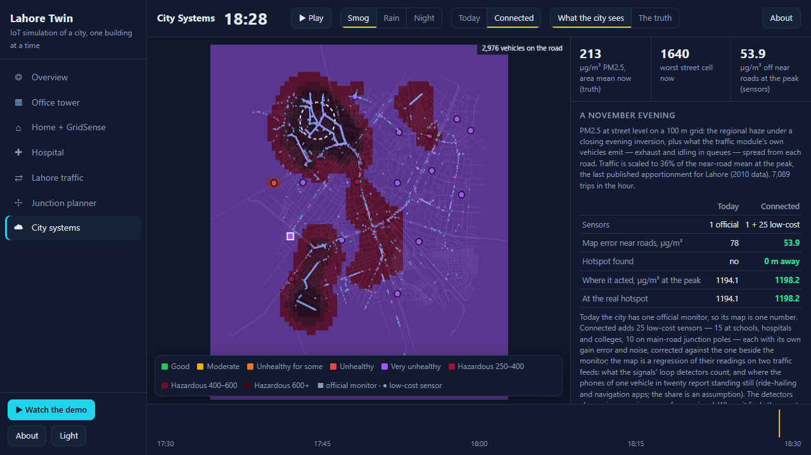
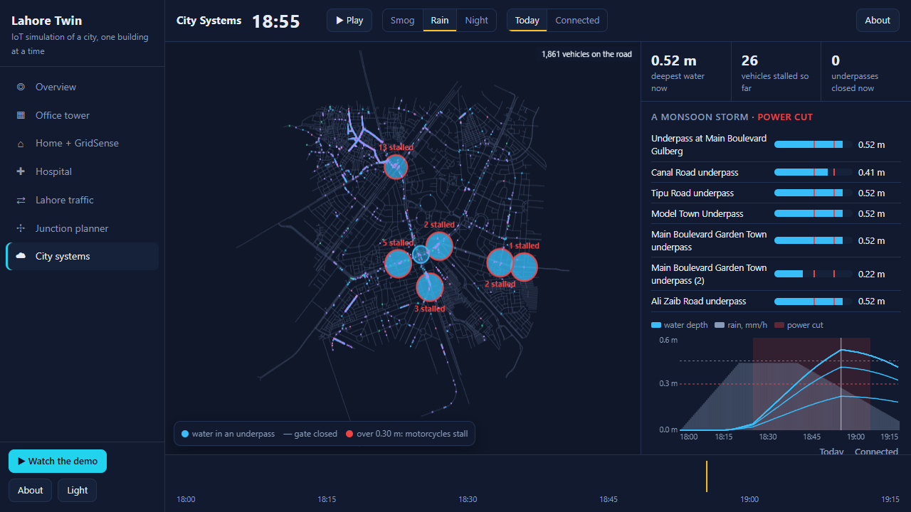
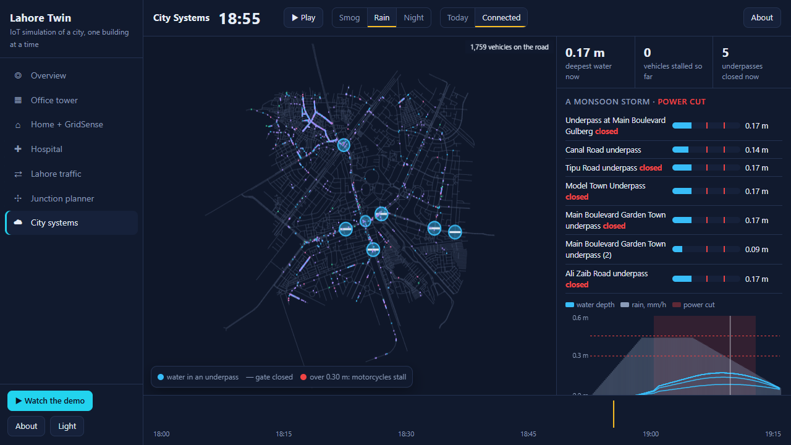
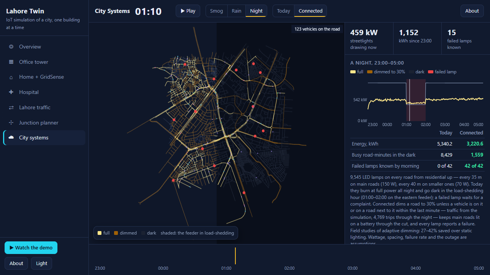

# Lahore Twin

IoT systems for a city like Lahore, simulated end to end in one app: an office tower,
a home on solar during load-shedding, a hospital, the city's traffic on real roads, a junction
planner, and city-wide smog sensors, underpass flood alarms and streetlights.
Every device — badge readers, motion and CO₂ sensors, inverters, bedside monitors, fridge
probes, traffic signals — sits behind an MQTT-style topic, so a real sensor can replace a
simulated one without changing the rules.


**Demo video (57 s):** [lahore-twin-demo.mp4](https://github.com/hammasbuilds/lahore-twin/releases/download/v0.4.0/lahore-twin-demo.mp4)

<!-- modules:start -->
| Module | What it simulates | Headline result | Status |
|---|---|---|---|
| **Office tower** | 3 floors (basement car park, ground, first), 36 staff and 4 visitors who also step out for lunch, the bank, a client or the school pick-up; couriers at reception; badge doors, office Wi-Fi, lights, AC, CO₂ | motion + CO₂ uses **31% less** light and AC energy than a fixed timetable; badges + Wi-Fi keep the evacuation roll-call within **0.27** people on average (badges alone: 1.79) | ready |
| **Home + GridSense** | double-storey house with roof solar (6 kWp), 10 kWh battery, a day of category IV load-shedding; a family whose children take the school van, go to tuition, and whose relatives visit in the evening; a gate counter | GridSense keeps the house lit through every cut (**93 → 0** dark minutes); a day's bill Rs 379 (inverter default) against Rs 385 (GridSense eco) | ready |
| **Hospital** | Lahore General Hospital campus from OpenStreetMap; Emergency Department (2 floors) and a ward on floor 2; patients' attendants and visitors | monitor alarms that sounded **99 → 38**, equipment search **96.4 → 0.9 min**, bed turnaround **70.4 → 20.4 min** | ready |
| **Lahore traffic** | Gulberg, Kalma Chowk, Garden Town, Canal Road from OpenStreetMap: flyovers, underpasses, one-way streets, lanes, 59 signals on a 60 s / 8 s green plan (the main road waits 15 s at red); 7,089 trips in the evening peak with stops at 432 real shops and amenities | adaptive signals finish **4,496 → 5,652** trips and cut time stopped at signals **184.1 → 70.2** vehicle-hours; fixed signals leave **1,447** vehicles gridlocked | ready |
| **Junction planner** | the evening's three worst junctions under five fixes (retime, adaptive, U-turn conversion, underpass), every vehicle drawn; ten Rescue 1122 calls from the real station | at Firozpur Road / Wahdat Road time lost goes **79.2 → 2.4** vehicle-hours with the best fix; a green wave gets the ambulance to the call in **3:53** against 4:03 | ready |
| **City systems** | on the same roads, driven by the traffic, every vehicle drawn: PM2.5 on a smoggy November evening with 25 low-cost sensors; 7 real underpasses in a monsoon storm with a power cut; 9,545 streetlights through a night of load-shedding | sensors cut the air map's error **78.0 → 53.9 µg/m³**; closed underpasses strand **34 → 0** vehicles; adaptive lights use **40% less** energy | ready |
<!-- modules:end -->

## Run it

```bash
run.bat                      # Windows: serves the app on http://127.0.0.1:8860
python serve.py              # anywhere: the same, standard library only
```

Open http://127.0.0.1:8860, pick a module, press Play. Opening `viewer/index.html` straight
from disk also works for everything except **Run with your values**, which needs the server.

```bash
python demo.py               # office    — writes viewer/replay.js
python demo_home.py          # home      — viewer/home_replay.js
python demo_hospital.py      # hospital  — viewer/hospital_replay.js
python demo_traffic.py       # traffic   — viewer/traffic_replay.js
python -m pytest -q          # 90 tests
python tools/sweep_traffic.py # traffic invariants over 3 mornings x 3 demand levels (~10 min)
```

Python 3.10+, standard library only. No network: the map data ships in `plans/osm/`.

## What you can put in, what comes out

| Module | Inputs (Run with your values) | Outputs |
|---|---|---|
| Office | day (seed), staff with desks, visitors | floor-by-floor plan with people, lights, AC and cars; energy and comfort per rule set; attendance, tailgating, roll-call from badges and from badges + Wi-Fi |
| Home | day, season, load-shedding category, solar kWp, battery kWh | each floor and the roof with fans, ACs, tank and panels; power flow; dark minutes, comfort, bill; every controller decision with its reason |
| Hospital | day, emergency arrivals (%), ward nurses per shift, alarm delay (s) | site, ED and ward floors with patients by triage colour; ED board, bed board, equipment list; waits, call and alarm response, search time, fridge excursions, bed turnaround |
| Junction planner | day (seed), trips per hour; then pick a junction, a fix, a call and a way on the page | a close map of each junction with the fix drawn; time lost, queue, delay, extra km and pedestrian cost per fix; the ambulance on its route with a time–distance diagram |
| City systems | evening (seed), trips per hour; then Smog / Rain / Night, Today / Connected, and what the city sees or the truth | PM2.5 map in US AQI bands with every sensor's reading and the hotspot found; underpass gauges, gates and stalled vehicles with depth and rain charts; every road's light level and power drawn; Today vs Connected for each |
| Traffic | evening or morning peak, day (seed), trips per hour | a streaming map that loads around the camera; follow any vehicle and see why it is driving and where it stops; the busiest shops; signals with countdowns; delay, stops, speed and the worst junctions per rule set |

Every module has an **About** panel with the same information, and a **Compare** tab that
puts its rule sets side by side for the whole day.

## Screenshots

**Office tower** — ground floor, the basement car park, attendance and the energy comparison.


**Home + GridSense** — the roof's panels and tank at midday, and the four controllers compared.


**Hospital** — the emergency board, the ward's beds, the campus from OpenStreetMap, and Today vs Connected.


**Lahore traffic** — the whole area, riding along with a motorcycle to the shop it parks at, the busiest places, a junction's signal phases with their countdowns, and fixed vs adaptive signals.


**Junction planner** — a U-turn conversion drawn on the real roads, and an ambulance on a green wave with its time–distance diagram.


**City systems** — the PM2.5 map the 25 sensors make, an underpass storm without and with level sensors, and the streetlights through load-shedding.






**Run with your values** — typed inputs, and the hospital day they produced (150% arrivals, 4 ward nurses, no alarm delay).


**About panels and the light theme.**


## Results

<!-- results:start -->
Every figure here is read from the replay the app shows, by `tools/results.py`;
`tests/test_readme_numbers.py` fails if any of them stops matching. Nothing is trained, so there is
no train, validation or test split: each module runs one seed under every rule set, on the same
people, patients or trips. Shares, rates and capacities that are assumptions are labelled in the code.

**Office tower**, one working day. *Source:* `viewer/replay.js` · seed 7, staff 36, visitors 4 · code digest `158b76eef069195c`

| | Fixed schedule | Motion | Motion + CO₂ |
|---|---|---|---|
| Lights + AC, kWh | 446.2 | 310.3 | 308.4 |
| Person-minutes in the dark | 34 | 8 | 4 |
| Lights switched off on someone | 6 | 27 | 12 |
| Room-minutes lit while empty | 16,766 | 4,650 | 4,475 |

Evacuation roll-call, people off from the truth (mean / worst); tailgates caught 11 of 17, false alarms 0:

| Door counters | Badge register | Register + tailgate alerts | Badges + phones on the Wi-Fi |
|---|---|---|---|
| 1.79 / 7 | 1.79 / 6 | 1.99 / 7 | **0.27 / 3** |

**Home + GridSense**, a June day of category IV load-shedding. *Source:* `viewer/home_replay.js` · seed 7, season June, category IV, pv_kwp 6.0, battery_kwh 10.0 · code digest `7959ad8c66a86133`

| | Inverter default | UPS circuit | GridSense eco | GridSense |
|---|---|---|---|---|
| House dark, min | 93 | 0 | 0 | 0 |
| Too hot to sleep, person-min | 396 | 675 | 675 | 416 |
| Day's bill, Rs | 379 | 548 | 385 | 492 |

**Hospital**, one day, same patients and events. *Source:* `viewer/hospital_replay.js` · seed 7, arrivals_pct 100, alarm_delay_s 15 · code digest `d289ab293342a710`

| | Today | Connected |
|---|---|---|
| HDU alarms that sounded | 99 | 38 |
| Brief real events that never sounded (the cost of the alarm delay) | 0 | 15 |
| Minutes searching for equipment | 96.4 | 0.9 |
| Drips run without a pump | 16 | 1 |
| Fridge minutes above 8 °C | 551 | 42 |
| Bed turnaround, median min | 70.4 | 20.4 |
| Hand hygiene: true / as reported, % | 36.3 / 62.5 | 36.5 / 36.1 |
| Door to doctor, median min | 16.7 | 18.0 |
| Relatives standing in the ED bays, mean | 11.9 | 6.1 |
| Ward visitor-minutes outside 16:00–18:00 | 3,010 | 19 |
| Most visitors at one bed | 4 | 2 |
| Families turned away after 18:00 (the cost of the pass desk) | 0 | 18 |

**Lahore traffic**, the evening peak on real roads; every signal's main road gets 60 s of green and
waits 15 s at red, so side roads get 8 s. *Source:* `viewer/traffic_replay.js` · seed 7, per_hour 8,000, minutes 60, period evening · code digest `a892e8b913776904`

| | Fixed signals | Adaptive signals |
|---|---|---|
| Trips | 7,089 | 7,089 |
| Trips finished | 4,496 | 5,652 |
| Gridlocked (standing 5+ min) at the end | 1,447 | 532 |
| Never got onto the road | 195 | 21 |
| Median delay of finished trips, s | 62.9 | 50.3 |
| Stops per trip | 6.62 | 5.62 |
| Stopped at signals, vehicle-hours | 184.1 | 70.2 |
| Mean speed, km/h | 25.1 | 30.6 |
| Stops at shops and amenities | 1,303 | 1,543 |

The median delay counts only trips that finished, so a gridlocked evening can show a lower median
than a flowing one: read it with the trips finished and the gridlocked count beside it.

**Junction planner**, the evening's three worst junctions, every fix on the same trips; vehicle-hours
lost within 350 m. *Source:* `viewer/junctions_replay.js` · seed 7, per_hour 8,000, minutes 30, trips 3,570 · code digest `56253818ef07b302`

| Junction | As today | Retime | Adaptive | U-turn conversion | Underpass |
|---|---|---|---|---|---|
| Firozpur Road / Wahdat Road | 79.2 | 5.6 | 41.4 | 2.4 (+329 km) | 9.4 |
| Ahmed Munir Shaheed Road / Malik Fazal Din Road | 136.8 | 136.8 | 136.1 | 116.0 (+63 km) | 138.1 |
| D/E Diagonal Road / North Avenue | 9.6 | 4.9 | 3.1 | 3.9 (+73 km) | 4.4 |

Rescue 1122, 10 calls from the real station:

| | No priority | Siren | Green wave |
|---|---|---|---|
| To the call, mean | 4:03 | 4:00 | **3:53** |
| On to hospital, mean (9 calls every way finished) | 2:23 | 2:21 | 2:14 |
| Red lights met | 6 | 7 | 0 |
| Signals preempted | 0 | 0 | 63 |

**City systems.** *Source:* `viewer/city_replay.js` · seed 7, per_hour 8,000 · code digest `51a75ba262086d6c`

| Smog, a November evening | One official monitor | + 25 low-cost sensors, loop counts and phone reports |
|---|---|---|
| Air-map error near roads, µg/m³ | 78.0 | **53.9** |
| Hotspot placed, m from the real one | not placed | 0 |
| PM2.5 at the real hotspot after adaptive signals there, µg/m³ | 1194.1 | 1198.2 |

Area mean at the peak 203.5 µg/m³; worst street cell 1,652.9 µg/m³.

| Monsoon storm with a power cut | Today | Connected |
|---|---|---|
| Deepest water, m | 0.52 | **0.17** |
| Vehicles stalled in water | 34 | **0** |
| Gridlocked | 839 | 534 |
| Rerouted round a closed underpass | 0 | 367 |
| Trips finished | 3,577 | 3,907 |
| Median delay of finished trips, s | 52.0 | 55.7 |

| Streetlights, 23:00–05:00 (9,545 lamps) | Today | Connected |
|---|---|---|
| Energy, kWh | 5,340.2 | **3,220.6** (40% less) |
| Busy road-minutes in the dark | 8,429 | **1,559** |
| Failed lamps known by morning | 0 of 42 | **42 of 42** |
<!-- results:end -->

## How it works

- **Engine** (`lahore_twin/`): a 1-second simulation per module on an MQTT-style bus in which
  every message carries its cause, so the viewer can answer "why did this happen".
- **Buildings**: rooms, doors and named spots as data (`plans/*.json`); floors are connected by
  stairs, lifts and ramps that cost their real climb; A* routes people through doors only.
- **Map data**: OpenStreetMap — the hospital campus outline and buildings, and the road network
  with lanes, one-way streets and bridge/tunnel layers.
- **Traffic**: Intelligent Driver Model following, lane changes when another lane is clearly
  better, priority to the bigger road, fixed or adaptive signals, left-hand driving; trips with
  purposes and stops at real places (kerb stops and off-road parking).
- **Viewer** (`viewer/`): one offline page per module inside a single app shell; each replays
  the simulator's recording and re-simulates nothing. `serve.py` runs new days with your values.
- **Hardware path**: `mqtt.py` bridges the bus to a real broker; `solar_assistant.py` maps a
  SolarAssistant inverter box onto the home's topics.

## Data and licence

Map data, shops and amenities © OpenStreetMap contributors, ODbL 1.0. Code: MIT (see `LICENSE`).
